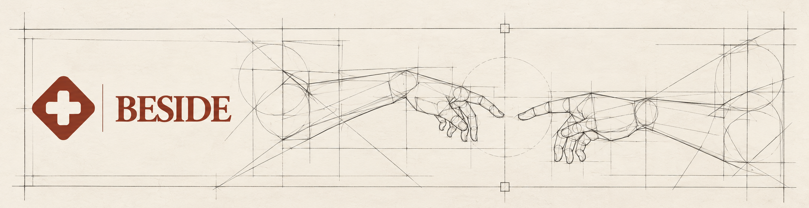

  
  
  
  
  
  
  
  

# BESIDE

**Một không gian đồng hành dành cho người đối diện với bệnh tật và những người ở bên cạnh họ.**

Khi việc chăm sóc trở thành một phần của cuộc sống, người bệnh và người thân cần thông tin dễ hiểu, nguồn lực phù hợp và một cách để cùng đi qua những việc cần làm. BESIDE được xây dựng với mong muốn hỗ trợ hành trình ấy bằng một trải nghiệm gần gũi và dễ sử dụng.

BESIDE là một phần của hệ sinh thái **BE** — *The life we carry. The lives we care for.*

Dự án được phát triển bởi **THIÊN ĐÌNH org**

## Dành cho ai?

- **Người cần được chăm sóc:** tiếp cận thông tin và nguồn lực hỗ trợ phù hợp với nhu cầu của mình.
- **Người thân và người chăm sóc:** có thêm điểm tựa để tìm hiểu và đồng hành trong quá trình chăm sóc.

## Định hướng sản phẩm

Website hướng đến việc tập hợp thông tin chăm sóc và tài nguyên hỗ trợ trong một nơi dễ tìm, dễ hiểu; đồng thời phát triển các trải nghiệm giúp người bệnh và người thân duy trì sự đồng hành. Các chức năng cụ thể sẽ được giới thiệu tại đây khi hoàn thiện.

> **Trạng thái:** BESIDE đang trong giai đoạn phát triển. Nội dung và các chức năng sẽ được cập nhật khi hoàn thiện.

## Giấy phép

Dự án được phát hành theo [Apache License 2.0](LICENSE).
